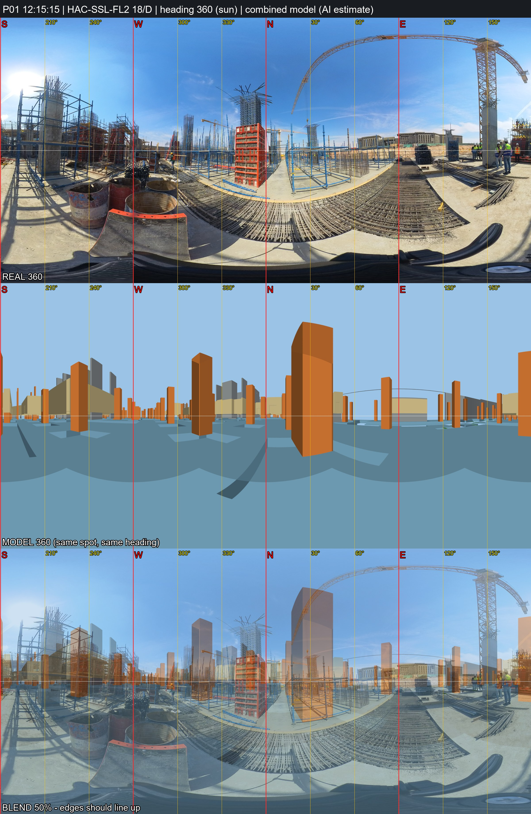

# P01 - HAC-SSL-FL2, grid 18/D

_Position and heading are AI estimates (no GPS). Generated by `Video_360_Analysis/vfinal.py`._

| | |
|---|---|
| Real 360 | [`IMG_20261031_121515_00_004.jpg`](IMG_20261031_121515_00_004.jpg) (18MP HDR bracket, EV 0); repeats not kept: IMG_20261031_121515_00_005, IMG_20261031_121515_00_006 |
| Combined model 360 | [`P01_combined_model.jpg`](P01_combined_model.jpg) (structure + architecture, same spot and heading) |
| Compare sheet | [`P01_compare.jpg`](P01_compare.jpg) (real / model / 50% blend) |
| Taken | 2026-10-31 12:15:15+02:00 |
| Storey / grid | HAC-SSL-FL2, 18/D; +0.9 m east, -0.9 m north of the crossing |
| IFC X, Y, Z (mm) | -343721600, -402342700, 153027 |
| Camera eye (IFC mm) | -343721600, -402342700, 153027 |
| Camera target (IFC mm) | -343721673, -402332700, 153027 |
| Easting, Northing (EPSG:22992) | 687413.67, 806394.52 |
| Lat, lon | 29.965500, 31.751906 - [Google Maps](https://maps.google.com/?q=29.965500,31.751906) |
| Heading | 359.6 deg (sun) |
| Site x, y, z (m) | 49.40, 37.30, 153.03 |
| Placement | moved by the video evidence (P01 in photo_vs_video.csv), 47.5 m from the Analysis/ spot; Analysis/ had x=62.27, y=82.97 (HAC-SSL-FL2) |

**Why here:** Sun heading 360 deg: finished government buildings and the excavation sand bank are due E/NE, so the camera is near the east edge of the basement; on the raft rebar mat with column cages starting (lowest storey with column starters = FL2); tower-crane mast cased in a concrete column ~8 m SE; red column formwork ~6 m NW. Grid chosen on the east side of the orthogonal block; exact grid unconfirmed. Model 360 compared: the model has no raft slab immediately E of the camera, consistent with the raft edge and open ground E in the photo; the grid itself is not confirmed.
