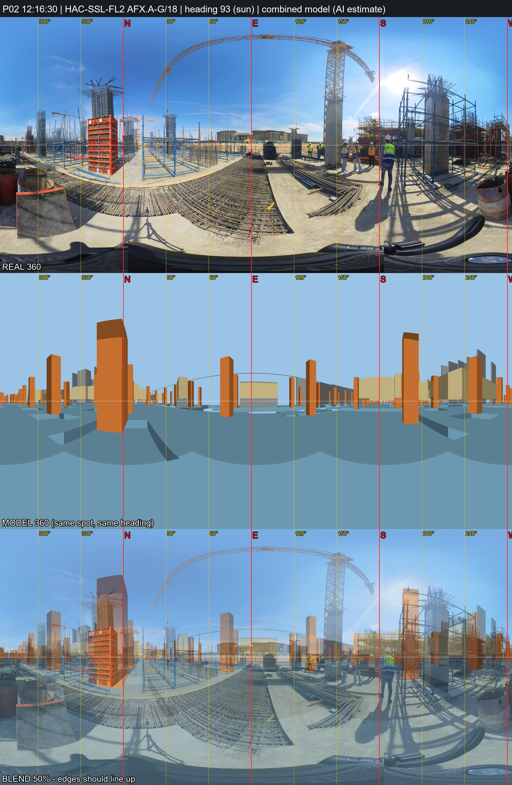

# P02 - HAC-SSL-FL2, grid AFX.A-G/18

_Position and heading are AI estimates (no GPS). Generated by `Video_360_Analysis/vfinal.py`._

| | |
|---|---|
| Real 360 | [`IMG_20261031_121630_00_007.jpg`](IMG_20261031_121630_00_007.jpg) (18MP HDR bracket, EV 0); repeats not kept: IMG_20261031_121630_00_008, IMG_20261031_121630_00_009 |
| Combined model 360 | [`P02_combined_model.jpg`](P02_combined_model.jpg) (structure + architecture, same spot and heading) |
| Compare sheet | [`P02_compare.jpg`](P02_compare.jpg) (real / model / 50% blend) |
| Taken | 2026-10-31 12:16:30+02:00 |
| Storey / grid | HAC-SSL-FL2, AFX.A-G/18; +0.7 m east, -1.9 m north of the crossing |
| IFC X, Y, Z (mm) | -343719600, -402343700, 153027 |
| Camera eye (IFC mm) | -343719600, -402343700, 153027 |
| Camera target (IFC mm) | -343709615, -402344252, 153027 |
| Easting, Northing (EPSG:22992) | 687415.67, 806393.52 |
| Lat, lon | 29.965491, 31.751927 - [Google Maps](https://maps.google.com/?q=29.965491,31.751927) |
| Heading | 93.2 deg (sun) |
| Site x, y, z (m) | 51.40, 36.30, 153.03 |
| Placement | moved by the video evidence (P01 in photo_vs_video.csv), 47.5 m from the Analysis/ spot; Analysis/ had x=64.27, y=81.97 (HAC-SSL-FL2) |

**Why here:** Taken 75 s after P01 showing the same red formwork (now NW) and crane mast (now SE, closer): same spot moved ~2 m east along the raft edge. Sun heading 93 deg. Model 360 compared: inconclusive - many identical column bays, so the grid stays an estimate.
