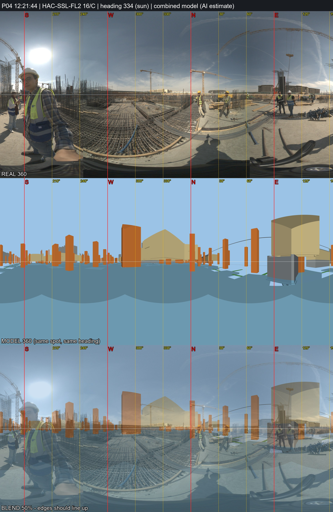

# P04 - HAC-SSL-FL2, grid 16/C

_Position and heading are AI estimates (no GPS). Generated by `Video_360_Analysis/vfinal.py`._

| | |
|---|---|
| Real 360 | [`IMG_20261031_122144_00_014.jpg`](IMG_20261031_122144_00_014.jpg) (72MP single, EV 0) |
| Combined model 360 | [`P04_combined_model.jpg`](P04_combined_model.jpg) (structure + architecture, same spot and heading) |
| Compare sheet | [`P04_compare.jpg`](P04_compare.jpg) (real / model / 50% blend) |
| Taken | 2026-10-31 12:21:44+02:00 |
| Storey / grid | HAC-SSL-FL2, 16/C; +2.0 m east, +0.0 m north of the crossing |
| IFC X, Y, Z (mm) | -343712129, -402327626, 153027 |
| Camera eye (IFC mm) | -343712129, -402327626, 153027 |
| Camera target (IFC mm) | -343716573, -402318668, 153027 |
| Easting, Northing (EPSG:22992) | 687423.14, 806409.59 |
| Lat, lon | 29.965636, 31.752005 - [Google Maps](https://maps.google.com/?q=29.965636,31.752005) |
| Heading | 333.6 deg (sun) |
| Site x, y, z (m) | 58.87, 52.37, 153.03 |
| Placement | Analysis/ photo position (locations.csv); Analysis/ had x=58.87, y=52.37 (HAC-SSL-FL2) |

**Why here:** 31 s after P03 with the same pit, compressor and workers in view rotated: same area ~2 m away. Sun heading 334 deg. Model 360 compared: inconclusive - many identical column bays, so the grid stays an estimate.
