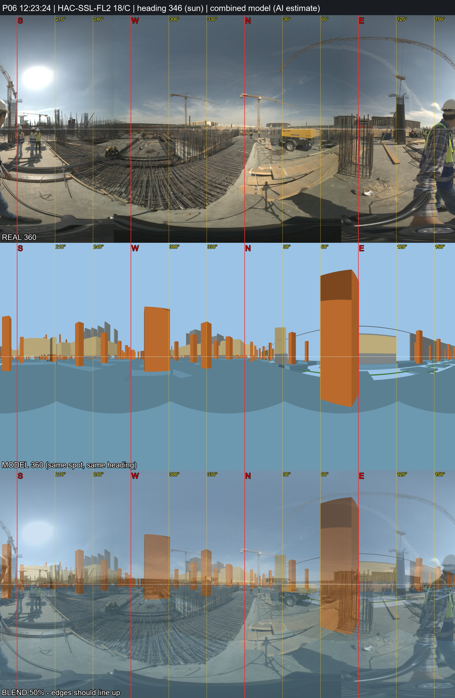

# P06 - HAC-SSL-FL2, grid 18/C

_Position and heading are AI estimates (no GPS). Generated by `Video_360_Analysis/vfinal.py`._

| | |
|---|---|
| Real 360 | [`IMG_20261031_122324_00_016.jpg`](IMG_20261031_122324_00_016.jpg) (72MP single, EV 0) |
| Combined model 360 | [`P06_combined_model.jpg`](P06_combined_model.jpg) (structure + architecture, same spot and heading) |
| Compare sheet | [`P06_compare.jpg`](P06_compare.jpg) (real / model / 50% blend) |
| Taken | 2026-10-31 12:23:24+02:00 |
| Storey / grid | HAC-SSL-FL2, 18/C; +0.0 m east, +0.0 m north of the crossing |
| IFC X, Y, Z (mm) | -343714129, -402341826, 153027 |
| Camera eye (IFC mm) | -343714129, -402341826, 153027 |
| Camera target (IFC mm) | -343716469, -402332104, 153027 |
| Easting, Northing (EPSG:22992) | 687421.14, 806395.39 |
| Lat, lon | 29.965508, 31.751983 - [Google Maps](https://maps.google.com/?q=29.965508,31.751983) |
| Heading | 346.5 deg (sun) |
| Site x, y, z (m) | 56.87, 38.17, 153.03 |
| Placement | Analysis/ photo position (locations.csv); Analysis/ had x=56.87, y=38.17 (HAC-SSL-FL2) |

**Why here:** 80 s after P05; compressor now N close by, long raft strip W/NW with workers tying rebar, column cages E: continued south ~5-8 m. Sun heading 346 deg. Model 360 compared: inconclusive - many identical column bays, so the grid stays an estimate.
