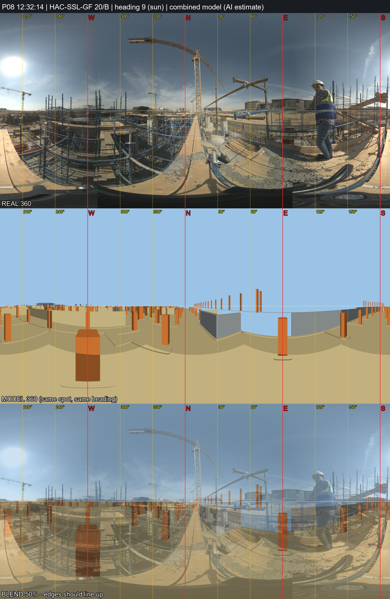

# P08 - HAC-SSL-GF, grid 20/B

_Position and heading are AI estimates (no GPS). Generated by `Video_360_Analysis/vfinal.py`._

| | |
|---|---|
| Real 360 | [`IMG_20261031_123214_00_024.jpg`](IMG_20261031_123214_00_024.jpg) (72MP single, EV 0) |
| Combined model 360 | [`P08_combined_model.jpg`](P08_combined_model.jpg) (structure + architecture, same spot and heading) |
| Compare sheet | [`P08_compare.jpg`](P08_compare.jpg) (real / model / 50% blend) |
| Taken | 2026-10-31 12:32:14+02:00 |
| Storey / grid | HAC-SSL-GF, 20/B; +2.4 m east, +0.0 m north of the crossing |
| IFC X, Y, Z (mm) | -343703329, -402358626, 163577 |
| Camera eye (IFC mm) | -343703329, -402358626, 163577 |
| Camera target (IFC mm) | -343701760, -402348750, 163577 |
| Easting, Northing (EPSG:22992) | 687431.94, 806378.59 |
| Lat, lon | 29.965355, 31.752094 - [Google Maps](https://maps.google.com/?q=29.965355,31.752094) |
| Heading | 9.0 deg (sun) |
| Site x, y, z (m) | 67.67, 21.37, 163.58 |
| Placement | Analysis/ plan position; storey = GF formwork deck (work/deck_decision.md), same eye height; Analysis/ had x=67.67, y=21.37 (HAC-SSL-B1) |

**Why here:** Camera on a timber/shoring deck about one storey above the raft: retaining wall and excavation bank close by to the E with the bank top near deck level, so a slab formwork deck near the east perimeter. Taken 9 min after P07. Sun heading 9 deg. Model 360 compared (uncast GF slab hidden): B1 columns below and perimeter walls to the E/NE, consistent with the retaining wall E in the photo; the grid itself is not confirmed.
