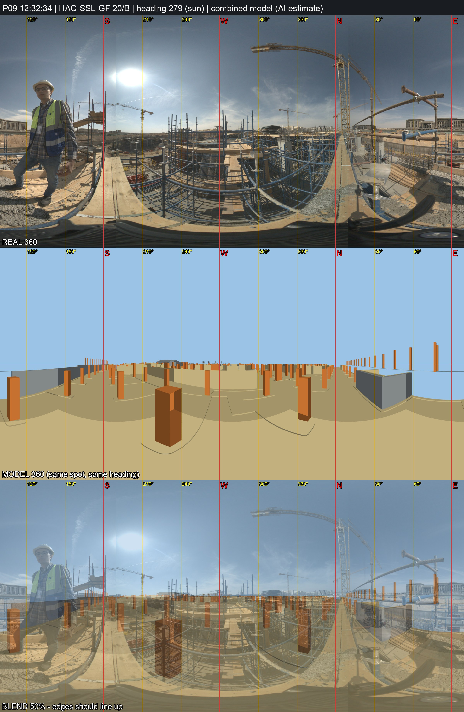

# P09 - HAC-SSL-GF, grid 20/B

_Position and heading are AI estimates (no GPS). Generated by `Video_360_Analysis/vfinal.py`._

| | |
|---|---|
| Real 360 | [`IMG_20261031_123234_00_025.jpg`](IMG_20261031_123234_00_025.jpg) (72MP single, EV 0) |
| Combined model 360 | [`P09_combined_model.jpg`](P09_combined_model.jpg) (structure + architecture, same spot and heading) |
| Compare sheet | [`P09_compare.jpg`](P09_compare.jpg) (real / model / 50% blend) |
| Taken | 2026-10-31 12:32:34+02:00 |
| Storey / grid | HAC-SSL-GF, 20/B; +2.4 m east, +2.0 m north of the crossing |
| IFC X, Y, Z (mm) | -343703329, -402356626, 163577 |
| Camera eye (IFC mm) | -343703329, -402356626, 163577 |
| Camera target (IFC mm) | -343713192, -402354978, 163577 |
| Easting, Northing (EPSG:22992) | 687431.94, 806380.59 |
| Lat, lon | 29.965373, 31.752094 - [Google Maps](https://maps.google.com/?q=29.965373,31.752094) |
| Heading | 279.5 deg (sun) |
| Site x, y, z (m) | 67.67, 23.37, 163.58 |
| Placement | Analysis/ plan position; storey = GF formwork deck (work/deck_decision.md), same eye height; Analysis/ had x=67.67, y=23.37 (HAC-SSL-B1) |

**Why here:** 20 s after P08 on the same deck (same crane N, retaining wall E): ~2 m further along the deck. Sun heading 279 deg. Model 360 compared: inconclusive - many identical column bays, so the grid stays an estimate.
