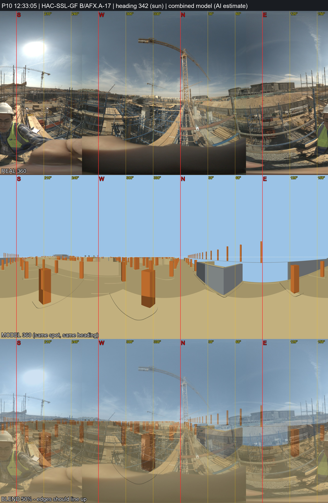

# P10 - HAC-SSL-GF, grid B/AFX.A-17

_Position and heading are AI estimates (no GPS). Generated by `Video_360_Analysis/vfinal.py`._

| | |
|---|---|
| Real 360 | [`IMG_20261031_123305_00_026.jpg`](IMG_20261031_123305_00_026.jpg) (72MP single, EV 0) |
| Combined model 360 | [`P10_combined_model.jpg`](P10_combined_model.jpg) (structure + architecture, same spot and heading) |
| Compare sheet | [`P10_compare.jpg`](P10_compare.jpg) (real / model / 50% blend) |
| Taken | 2026-10-31 12:33:05+02:00 |
| Storey / grid | HAC-SSL-GF, B/AFX.A-17; +2.4 m east, -3.6 m north of the crossing |
| IFC X, Y, Z (mm) | -343703329, -402354626, 163577 |
| Camera eye (IFC mm) | -343703329, -402354626, 163577 |
| Camera target (IFC mm) | -343706439, -402345122, 163577 |
| Easting, Northing (EPSG:22992) | 687431.94, 806382.59 |
| Lat, lon | 29.965391, 31.752094 - [Google Maps](https://maps.google.com/?q=29.965391,31.752094) |
| Heading | 341.9 deg (sun) |
| Site x, y, z (m) | 67.67, 25.37, 163.58 |
| Placement | Analysis/ plan position; storey = GF formwork deck (work/deck_decision.md), same eye height; Analysis/ had x=67.67, y=25.37 (HAC-SSL-B1) |

**Why here:** 31 s after P09, same deck walkway: ~2 m further. View S over formwork decks of the neighbouring bays. Sun heading 342 deg. Model 360 compared: inconclusive - many identical column bays, so the grid stays an estimate.
